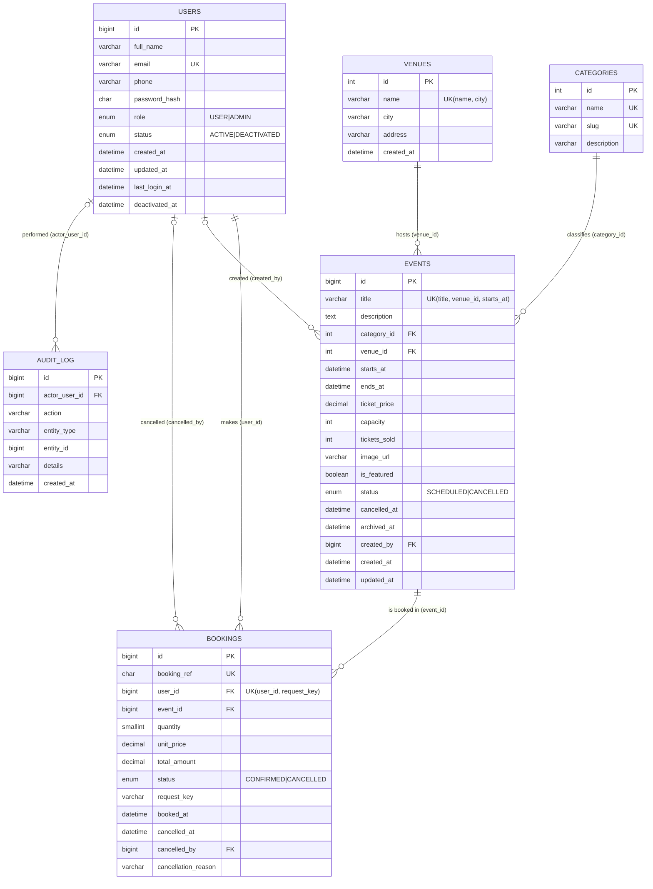

# BookMatrix — Database design

MySQL 8 (InnoDB, utf8mb4). The schema lives in [`src/main/resources/db/schema.sql`](../src/main/resources/db/schema.sql) and is applied automatically at start-up by `DatabaseInitializer`. Every statement is `CREATE TABLE IF NOT EXISTS`, so the app starts from an empty database. `reference-data.sql` inserts the 8 categories with `INSERT IGNORE`.

## 1. Tables

| Table | Purpose | Key columns |
|---|---|---|
| `users` | everyone who can log in | `email` (unique), `password_hash` (BCrypt), `role` USER/ADMIN, `status` ACTIVE/DEACTIVATED |
| `categories` | reference list (Music, Comedy, …) | `name`, `slug` (both unique) |
| `venues` | a place in a city; shared by many events | unique (`name`, `city`) |
| `events` | an event **and its inventory** | `capacity`, `tickets_sold`, `ticket_price`, `starts_at`, `ends_at`, `status` SCHEDULED/CANCELLED, `archived_at`, `is_featured` |
| `bookings` | a user's purchase of N tickets for one event | `booking_ref` (unique), `quantity`, `unit_price` (price at booking time), `total_amount`, `status` CONFIRMED/CANCELLED, `request_key`, cancellation columns |
| `audit_log` | append-only history of important actions | `actor_user_id`, `action`, `entity_type`, `entity_id`, `details` |

Six core tables, plus `event_seats` and `payments` (added by migration `V2__payments_and_seats.sql`) for reserved seating and the demo payment gateway: eight tables in total.

## 2. ER diagram (matches `schema.sql`)



(Mermaid renders in GitHub and in VS Code's Markdown preview.)

## 3. Relationships

- **One-to-many:** category → events, venue → events, user → bookings, event → bookings, user → audit entries.
- **Many-to-many:** users ↔ events, resolved **through** `bookings`, which also carries the quantity, price and status of each purchase.
- **Optional (nullable) links:** `events.created_by`, `bookings.cancelled_by`, `audit_log.actor_user_id`. These use `ON DELETE SET NULL` so history survives if an account is ever removed.
- No one-to-one relationships were needed.

## 4. Constraints (data integrity enforced by MySQL itself)

| Constraint | Rule |
|---|---|
| `uq_users_email` | one account per email (emails are stored lower-case) |
| `uq_events_slot` | no duplicate event: same title + venue + start time |
| `uq_venues_name_city` | a venue is stored once per city |
| `uq_bookings_ref` | booking references are unique |
| `uq_bookings_request` (`user_id`, `request_key`) | **a retried or double-clicked booking request can never create a second booking** |
| `chk_events_sold` `tickets_sold <= capacity` | **overselling is impossible at the database level** |
| `tickets_sold INT UNSIGNED` | inventory can never go negative |
| `chk_events_capacity` 1..100000, `chk_events_price` 0..1000000, `chk_events_times` `ends_at > starts_at` | valid event data |
| `chk_events_cancel`, `chk_bookings_cancel`, `chk_users_deactivated` | status and timestamp always agree (e.g. CANCELLED ⇔ `cancelled_at` set) |
| `chk_bookings_quantity` 1..10, `chk_bookings_total` `total = unit_price × quantity` | consistent booking maths |
| FKs with `ON DELETE RESTRICT` (bookings → users/events, events → categories/venues) | cannot delete something that history points to |

## 5. Indexes

| Index | Used by |
|---|---|
| `idx_events_public (archived_at, status, starts_at)` | public listings ("upcoming, not archived, by date") |
| `idx_events_starts`, `idx_events_price`, `idx_events_category`, `idx_events_venue` | date/price sorting and category/venue filters |
| `idx_venues_city` | city filter |
| `idx_bookings_user (user_id, booked_at)` | "My bookings", newest first |
| `idx_bookings_event (event_id, status)` | bookings per event, inventory recalculation |
| `idx_bookings_status (status, booked_at)` | admin booking filters, dashboard |
| `idx_users_role_status` | admin user filters, last-admin check |
| `idx_audit_created`, `idx_audit_entity` | activity log |

Unique constraints also act as indexes (email, booking reference, slugs).

## 6. Data types

- Money uses `DECIMAL(10,2)` / `DECIMAL(12,2)` and Java `BigDecimal`, never floating point.
- Times use `DATETIME`. The application always passes "now" from Java (`TimeProvider`), so Java and SQL agree on the clock.
- Statuses and roles use `ENUM`, so invalid values are rejected by MySQL.
- `password_hash` is `CHAR(60)`, the exact BCrypt length.

## 7. Transactions and inventory consistency

Inventory is the `tickets_sold` counter on `events`. It changes **only** inside transactions in `BookingService` and `EventService`:

**Book** (`BookingService.book`)
```sql
SELECT ... FROM events e ... WHERE e.id = ? FOR UPDATE OF e;          -- 1. lock the event row
SELECT ... FROM bookings WHERE user_id = ? AND request_key = ?;        -- 2. duplicate submit? return it
UPDATE events SET tickets_sold = tickets_sold + ?                      -- 3. atomic conditional update
 WHERE id = ? AND status='SCHEDULED' AND archived_at IS NULL AND starts_at > ?
   AND tickets_sold + ? <= capacity;                                   --    0 rows => not enough tickets
INSERT INTO bookings (...);                                            -- 4. the booking, price frozen
INSERT INTO audit_log (...);
COMMIT;                                                                -- any failure => ROLLBACK
```

**Cancel** (`BookingService.cancel`)
```sql
SELECT ... FROM bookings b ... WHERE b.booking_ref = ? FOR UPDATE OF b;
UPDATE bookings SET status='CANCELLED', ... WHERE id = ? AND status='CONFIRMED';   -- 1 row only once
UPDATE events SET tickets_sold = tickets_sold - ? WHERE id = ? AND tickets_sold >= ?;
COMMIT;
```
The guarded `WHERE status='CONFIRMED'` means a second, simultaneous cancellation changes 0 rows, so **inventory is restored exactly once**.

**Cancel event** (`EventService.cancel`): in one transaction, every confirmed booking is cancelled, `tickets_sold` is reset to 0 and the event is marked CANCELLED.

**Why this is safe across many app instances:** locks, conditional updates and CHECK constraints live in MySQL, not in Java memory. `ConcurrencyIntegrationTest` fires 30 threads at a 10-ticket event and proves exactly 10 bookings succeed. The admin **Inventory** page also recomputes `SUM(quantity)` of confirmed bookings per event and flags any mismatch.

## 8. Deletion and retention policy

| Entity | Policy |
|---|---|
| Event without bookings | real `DELETE` |
| Event with bookings | **archive** (`archived_at`), only after it is cancelled or completed; it can be restored |
| User without bookings closing their account | real `DELETE` |
| User with bookings closing their account | upcoming bookings cancelled (tickets released), account **DEACTIVATED**, history kept |
| Bookings | never deleted; cancellation is a status change with who, when and why |
| Audit log | append-only |

## 9. Setup

See the README section "Installation and database setup". In short: run `scripts/setup-database.sql` once, fill in `.env`, start the app, and tables are created automatically. Tests use the separate `bookmatrix_test` database, and the test base class refuses to run against any database whose name does not end in `_test`.
